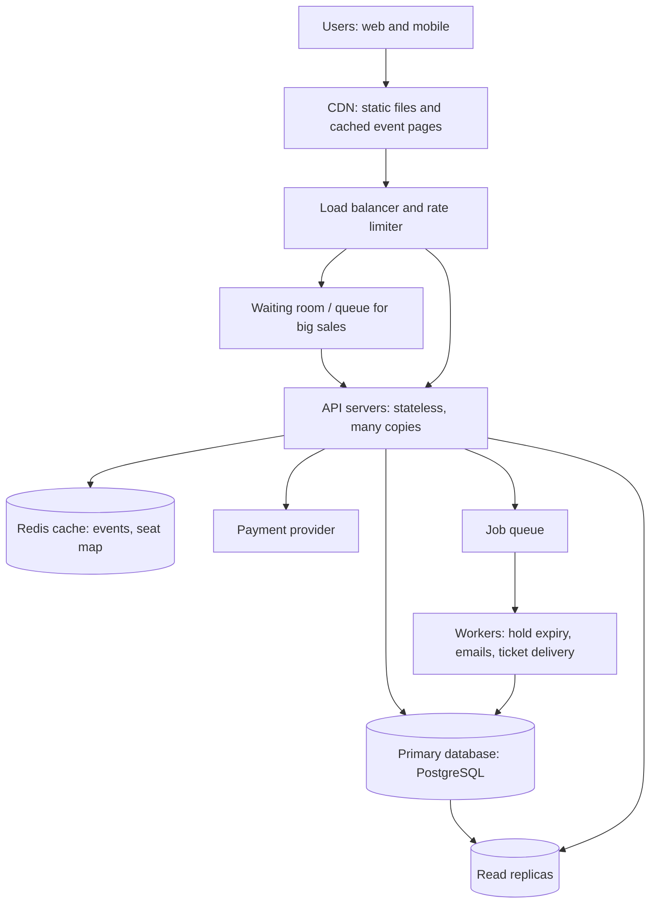

# TicketHub: Event Ticketing System Design

TicketHub is a website that sells tickets for concerts and events. This document follows the six-part framework: requirements, estimates, API, data model, architecture, trade-offs. It also explains how the design prevents two people from buying the same seat.

---

## 1. Requirements

### Functional

1. Users can register, log in and log out.
2. Users can browse and search upcoming events.
3. Users can view an event and its seat map, with each seat shown as available, held or sold.
4. Users can hold seats (up to 6 per order) for a short time while they pay.
5. Users can pay for held seats and receive confirmed tickets.
6. Users can view their tickets (and past orders).
7. Held seats that are not paid for are released automatically.

### Non-functional

| Quality | Requirement |
|---|---|
| **Speed** | Browsing pages respond in under 300 ms (p95). Holding seats responds in under 500 ms (p95), even during a big sale. |
| **Correctness** | A seat is never sold to two people, under any amount of concurrent traffic. A paid order always results in a ticket, and a ticket is never issued without payment. Orders are never lost (durable storage). |
| **Fairness** | During a big sale, people are served roughly first-come-first-served. One person cannot grab all seats (limit of 6 per order, rate limits per user and per IP to slow bots). |
| **Availability** | 99.9% for browsing. The system degrades gracefully (queue people, never crash) when overloaded. |
| **Security** | Passwords are hashed, all traffic uses HTTPS, card details never touch our servers (a payment provider handles them). |

---

## 2. Estimates

### Normal day

- Page views: 50,000 visitors × 10 pages = **500,000 page views/day**
- Average rate: 500,000 / 86,400 s ≈ **6 requests/second**
- Allowing for busy hours (about 10× the average): **~60 requests/second**
- Ticket sales: 5,000/day ≈ **0.06 sales/second** (about 1% of traffic is a purchase; the rest is reading)
- Storage: 5,000 orders/day ≈ 1.8 million orders/year. That is small, and one database handles it easily.

### Big sale (200,000 people, 20,000 seats, 10 minutes)

- Window: 10 minutes = 600 seconds
- Arrival rate: 200,000 / 600 ≈ **333 new users/second**
- Each user makes about 10 requests (open event, load seat map, refresh it, try to hold, pay): 2,000,000 requests / 600 s ≈ **3,300 requests/second**
- Hold attempts: if each user tries about 3 times, 600,000 attempts / 600 s ≈ **1,000 write attempts/second**, all fighting over the same 20,000 rows
- Competition: 200,000 buyers for 20,000 seats is **10 people per seat**. Most users will lose, and the system must tell them quickly and clearly.
- Sales: all 20,000 seats could sell out in a few minutes, so real peaks are above 33 sales/second (20,000 / 600).

### Comparison

| Measure | Normal day | Big sale | Ratio |
|---|---|---|---|
| Requests/second | ~6 average (~60 busy hour) | ~3,300 | ~550× the average, ~55× a busy hour |
| Writes (hold attempts) /second | ~0.06 | ~1,000 | ~16,000× |
| Tickets sold | 5,000 per day | 20,000 in about 10 minutes | 4× a whole day's sales in 10 minutes |

The important lesson: the problem is not total volume (3,300 requests/second is moderate) but **concentration**. Thousands of writes target the same 20,000 rows at the same time. The design must therefore (a) protect the database from the crowd and (b) stay correct under heavy contention.

---

## 3. API

REST over HTTPS, JSON bodies. Everything except browsing requires `Authorization: Bearer <token>`.

| # | Method and path | Purpose | Notes |
|---|---|---|---|
| 1 | `POST /auth/login` | Log in, get a token | Body: `email`, `password` |
| 2 | `GET /events?query=&date=&page=` | Browse and search events | Public, cacheable |
| 3 | `GET /events/{eventId}` | Event details (artist, venue, date, price tiers) | Public, cacheable |
| 4 | `GET /events/{eventId}/seats` | Seat map with each seat's status | Cached for 1–2 seconds |
| 5 | `POST /events/{eventId}/holds` | Hold seats. Body: `{"seatIds": [101, 102]}` | Returns `201` with `holdId` and `expiresAt`, or `409 Conflict` if any seat is taken |
| 6 | `DELETE /holds/{holdId}` | Release a hold early | Optional, frees seats sooner |
| 7 | `POST /orders` | Pay for a hold. Body: `{"holdId": ..., "paymentToken": ...}` with header `Idempotency-Key` | Returns `201` with the order, `402` if payment fails, `410 Gone` if the hold expired |
| 8 | `GET /me/tickets` | View my tickets | Seats with order, event and ticket code |

Notes:

- The `Idempotency-Key` header makes a retried payment request safe. If the user double-clicks or the network retries, they are charged once.
- `409 Conflict` on holds is the normal, expected answer for a lost race. The client then refreshes the seat map.

---

## 4. Data model

Four tables. Primary keys are `id`; `FK` means foreign key.

### users
| Column | Type | Notes |
|---|---|---|
| id | bigint PK | |
| email | text, UNIQUE, NOT NULL | |
| password_hash | text, NOT NULL | |
| created_at | timestamp | |

### events
| Column | Type | Notes |
|---|---|---|
| id | bigint PK | |
| name | text, NOT NULL | |
| venue | text | |
| starts_at | timestamp | |
| sale_starts_at | timestamp | When tickets go on sale |
| total_seats | int | |

### seats
One row per physical seat per event. This is the table that matters most.

| Column | Type | Notes |
|---|---|---|
| id | bigint PK | |
| event_id | bigint FK → events.id | |
| section, row_label, seat_number | text/int | |
| price | numeric | |
| status | text | `AVAILABLE`, `HELD`, `SOLD` |
| held_by | bigint FK → users.id, nullable | Who holds it |
| hold_expires_at | timestamp, nullable | When the hold lapses |
| order_id | bigint FK → orders.id, nullable | Set when sold |
| ticket_code | text, UNIQUE, nullable | Code/QR shown on the ticket once sold |

Constraints:

- `UNIQUE (event_id, section, row_label, seat_number)`: a physical seat exists once.
- `CHECK (status <> 'SOLD' OR order_id IS NOT NULL)`: a sold seat must belong to an order.
- `CHECK (status <> 'HELD' OR (held_by IS NOT NULL AND hold_expires_at IS NOT NULL))`.
- Index on `(event_id, status)` for the seat map, and on `hold_expires_at` for the expiry job.

### orders
| Column | Type | Notes |
|---|---|---|
| id | bigint PK | |
| user_id | bigint FK → users.id | |
| event_id | bigint FK → events.id | |
| total_amount | numeric | |
| status | text | `PAID`, `FAILED`, `REFUNDED` |
| payment_ref | text | Reference from the payment provider |
| idempotency_key | text, UNIQUE | Stops duplicate orders from retries |
| created_at | timestamp | |

### Relationships

- A **user** has many **orders** (1 : N).
- An **event** has many **seats** (1 : N) and many **orders** (1 : N).
- An **order** has many **seats** (1 : N, through `seats.order_id`). A seat belongs to at most one order, and that is exactly the guarantee we want.
- "View my tickets" is a query: seats whose `order_id` belongs to an order of this user.

---

## 5. How double-booking is prevented

Two people click the same seat at the same moment. We make sure only one wins using **atomic conditional updates inside a transaction**, backed by constraints. We do not read the seat first and then write it, because two people could both read "available" before either writes.

### Step 1: Holding (the contested step)

```sql
BEGIN;

UPDATE seats
SET status = 'HELD',
    held_by = :user_id,
    hold_expires_at = now() + interval '5 minutes'
WHERE event_id = :event_id
  AND id IN (:seat_ids)
  AND (status = 'AVAILABLE'
       OR (status = 'HELD' AND hold_expires_at < now()));

-- The application checks the number of rows updated.
-- If it equals the number of seats requested: COMMIT.
-- If fewer (someone else got there first): ROLLBACK and return 409 Conflict.
```

Why this works:

- The check ("is it available?") and the change ("make it mine") happen in **one statement**. There is no gap between them for another request to slip into.
- When two transactions update the same row, the database takes a **row lock**. The second one waits, then re-checks the `WHERE` condition on the new state, sees `HELD`, and updates 0 rows. Exactly one request wins.
- Requests for multiple seats are all-or-nothing. If one seat fails, the whole transaction rolls back, so no one ends up with half an order.
- Seat IDs are always processed in sorted order, so two buyers who want overlapping seats cannot deadlock each other.

### Step 2: Paying (confirming the sale)

After the payment provider confirms payment:

```sql
BEGIN;

INSERT INTO orders (...) VALUES (...);  -- the idempotency_key UNIQUE prevents duplicate orders

UPDATE seats
SET status = 'SOLD', order_id = :order_id, held_by = NULL, hold_expires_at = NULL
WHERE id IN (:seat_ids)
  AND status = 'HELD'
  AND held_by = :user_id
  AND hold_expires_at > now();

-- If rows updated <> seats in the order: ROLLBACK and refund.
COMMIT;
```

Only the person who holds the seat, with a hold that has not expired, can turn it into a sale. To avoid charging someone whose hold lapses mid-payment, the hold is extended by a couple of minutes when payment starts. If something still goes wrong (the hold expired and another buyer took the seat), the transaction rolls back and the payment is automatically refunded.

### Step 3: Constraints as the last line of defence

Even if there were a bug in the application code, the database protects us:

- `UNIQUE (event_id, section, row_label, seat_number)` means a physical seat exists only once.
- `CHECK (status <> 'SOLD' OR order_id IS NOT NULL)` means a sold seat always points to exactly one order. A single column can hold only one `order_id`, so a seat cannot belong to two orders.
- `idempotency_key UNIQUE` means a retried payment cannot create two orders.

### Step 4: Releasing abandoned holds

A background worker runs every 30 seconds and sets expired holds back to `AVAILABLE`. Because the hold query also accepts "HELD but expired", correctness never depends on the worker running on time. The worker only keeps the seat map tidy.

### Why the seat-map cache cannot cause double-booking

The cached seat map (1–2 seconds old) may show a seat as available when it was just taken. That only means a user may click a seat and get `409 Conflict`. The cache is for display. The decision always happens in the database, in the transaction above.

---

## 6. Architecture



### Components

- **CDN:** serves images, JavaScript and cached event pages from servers close to users. During a big sale, most of the crowd's page loads never reach our servers.
- **Load balancer and rate limiter:** spreads requests across API servers and drops abusive traffic (bots, a single IP sending hundreds of requests). This supports fairness.
- **Waiting room:** for a big sale, users are placed in a queue and admitted at a controlled rate (for example, 1,000 per minute) that the database can handle. Each admitted user receives a signed pass that the hold endpoint requires. This turns a 200,000-person spike into a steady flow, and people are admitted in the order they arrived.
- **API servers:** stateless (no data stored on them), so we can add more copies quickly before a known sale. They contain the business logic and the transactions from section 5.
- **Redis cache:** stores event details and the seat map for 1–2 seconds. This absorbs the repeated "refresh the seat map" requests that would otherwise be thousands of queries per second. It also keeps the queue positions and rate-limit counters.
- **Primary database (PostgreSQL):** the single source of truth. All holds and sales go through it, so the row locks give us correctness. Read replicas handle the normal reading (search, my tickets).
- **Payment provider:** handles cards and returns a confirmation. We never store card details. Calls to it are done with idempotency keys.
- **Job queue and workers:** do slow work outside the user's request: releasing expired holds, sending confirmation emails, generating ticket codes.

### How it survives the big sale

1. **Before the sale:** we add API servers ahead of time (we know the date) and warm the cache for the event.
2. **The crowd arrives:** the CDN and waiting room absorb it. The 3,300 requests/second land mostly on the CDN and cache, not on the database.
3. **The database sees only what it can handle:** admission is throttled, and the seat map is read from cache. Only hold and payment writes reach the primary, and the conditional updates are short and fast.
4. **Contention is resolved by the database:** thousands of people fighting for the same seats are serialised by row locks. Losers get a fast `409` and see an updated map instead of timing out.
5. **If something fails:** the waiting room slows admission instead of letting the system collapse, and idempotency keys make retries safe.

---

## 7. Trade-offs

1. **Seat holds with a timer: fairness versus inventory.**
   Holding seats for 5 minutes protects a buyer who is entering payment details, but a person who abandons the page locks those seats until the hold expires, and other people see the concert as "sold out" when it is not. A shorter hold (for example, 2 minutes) frees seats faster but rushes buyers and causes more failed payments. We chose 5 minutes, and abandoned seats return to the pool automatically. We also release a hold early when the user leaves the checkout.

2. **One primary database: correctness versus scalability.**
   Sending every hold and sale to a single primary database gives us strong, simple guarantees (row locks, transactions). The cost is that writes cannot be spread across many databases, so the primary is our ceiling. At about 1,000 writes/second with short transactions this is acceptable. If we grew far beyond that, we could partition seats by event, since different events never compete for the same rows. We rejected an "eventually consistent" design because selling a seat twice is far worse than being slightly slower.

3. **Waiting room: protection versus user experience.**
   The queue keeps the system alive and gives a fair order, but it adds friction: users wait, and some leave. The alternative, letting everyone in, would likely crash the site and favour people with the fastest connections or bots. For high-demand events we choose the queue. For normal events we turn it off.

4. **Cached seat map: speed versus freshness.**
   A seat map that is 1–2 seconds old cuts database reads enormously, but sometimes shows a taken seat as available, causing a `409`. We accept this because the database makes the real decision (section 5) and a `409` costs the user only one click.